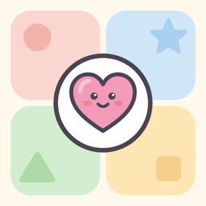
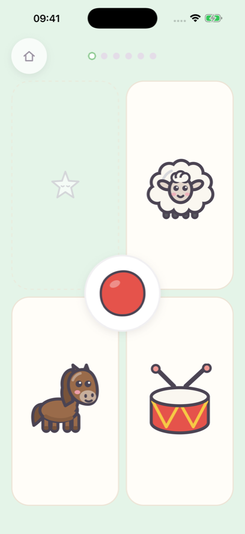
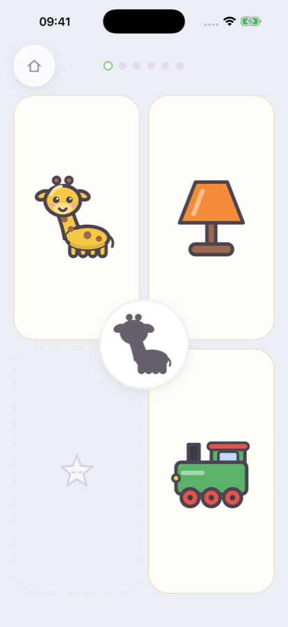
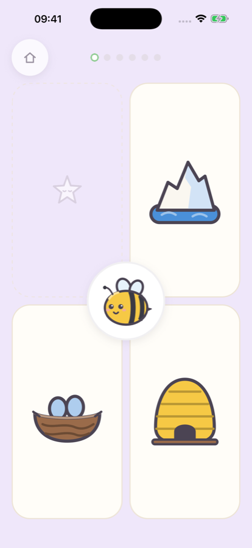
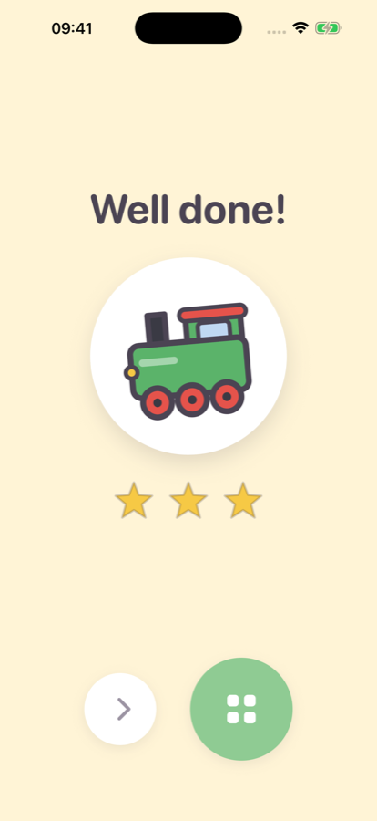

<p align="center">
  
</p>

<h1 align="center">Pasujki</h1>

<p align="center">
  A calm matching game for children aged 2–5. Offline, no ads, no purchases, no data collected.<br/>
  <a href="https://tobob.github.io/pasujki-site/">Website</a> ·
  <a href="https://tobob.github.io/pasujki-site/privacy/">Privacy</a> ·
  <a href="https://tobob.github.io/pasujki-site/terms/">Terms</a>
</p>

<p align="center">
  
  
  
  
</p>

## What it is

Four pictures sit in the corners of the screen. A prompt appears in the middle: a picture, a colour, a shape, a shadow or a pattern. The child drags it to the corner where it belongs. The youngest players can just tap the corner.

- **8 worlds, 68 levels:** The same, Colours, Shapes, Shadows, Patterns, Who goes with whom?, Weather and pairs, and Make-believe (where every answer is right).
- **Calm by design:**
  - Slow, soft animations and pastel colours, with nothing flashing.
  - No timers, no streaks and no "wrong" buzzer. A mistake just floats back to the middle.
  - The rules are in [docs/DESIGN.md](docs/DESIGN.md), and the research behind them is in [docs/CALM_DESIGN_RESEARCH.md](docs/CALM_DESIGN_RESEARCH.md).
- **Made for kids:**
  - Fully offline, with no network requests, no analytics and no accounts.
  - Settings and the privacy policy sit behind a parental gate: hold for 3 seconds, then answer a multiplication written in words.
  - The only links out of the app are behind that gate too: rating on the App Store / Google Play and a feedback page on [pastelki.club](https://pastelki.club) that opens in the browser. On the sixth visit to the parents' area a grown-up is asked once, gently, whether they like Pasujki.
- **8 languages** for the text parents see: Polish, English, German, French, Italian, Spanish, Portuguese and Dutch. Playing needs no reading.
- **Everything is made from scratch.** The illustrations are SVG React components and the music and sounds are synthesised in Python. There are no third-party assets.

## Tech stack

- [Expo](https://expo.dev) SDK 58, React Native 0.88, React 19 and TypeScript.
- [Expo Router](https://docs.expo.dev/router/introduction/) for the screens.
- [`react-native-svg`](https://github.com/software-mansion/react-native-svg) for all artwork.
- [`react-native-reanimated`](https://docs.swmansion.com/react-native-reanimated/) and [`react-native-gesture-handler`](https://docs.swmansion.com/react-native-gesture-handler/) for dragging and animation.
- [`expo-audio`](https://docs.expo.dev/versions/latest/sdk/audio/) for music and sound effects.
- [`expo-sqlite/kv-store`](https://docs.expo.dev/versions/latest/sdk/sqlite/) for local progress.
- [`expo-localization`](https://docs.expo.dev/versions/latest/sdk/localization/) to pick the device language.
- [EAS Build and Submit](https://docs.expo.dev/eas/) for store releases.

## Run it locally

### Requirements

- Node.js 20+ and npm.
- For iOS: macOS with Xcode 26+, an iOS simulator runtime and CocoaPods.
- For Android: Android Studio with an emulator.

The app uses native modules that Expo Go doesn't include, so it runs as a [development build](https://docs.expo.dev/develop/development-builds/introduction/):

```bash
git clone https://github.com/tobob/pasujki.git
cd pasujki
npm install
npx expo run:ios       # or: npx expo run:android
```

This command generates the native `ios/` or `android/` folder, builds the app and starts Metro. The native folders are not committed; see [Continuous Native Generation](https://docs.expo.dev/workflow/continuous-native-generation/). After the first build, `npx expo start` is enough.

To try another language in the iOS simulator, either change the simulator's language in Settings or launch the app like this:

```bash
xcrun simctl launch booted com.tobob.pasujki -AppleLanguages "(de)"
```

### Checks

```bash
npm run check            # runs all of the checks below
npm run lint             # expo lint
npm run typecheck        # tsc --noEmit
npm run validate-levels  # every round has exactly one fair answer; variety rules; age bands
npm run check-i18n       # all 8 languages are complete
npm run check-art        # illustration rules (docs/ART_STYLE.md)
```

## Project structure

```
src/
├── app/                    # Expo Router screens: home, map, world, play, level complete, parents' area
├── components/             # game board, quadrants, parental gate, top bar, drifting stars, …
├── game/
│   ├── types.ts            # shared contract: item, colour, texture, shape and sound ids
│   ├── palette.ts          # calm colour palette (every picture uses these exact colours)
│   ├── item-attributes.ts  # what each picture is: colour, outline, food, home, baby, …
│   ├── levels.ts           # seeded level generator (68 levels in 8 worlds)
│   └── engine/             # progression and unlocking, sound
├── art/                    # every picture, texture and shape as an SVG component
├── audio/                  # sound registry
├── i18n/                   # 8 locales: UI strings, world titles, hints, privacy policy
└── storage/                # local progress and settings (SQLite key-value store)
assets/audio/               # generated music and sound effects (.m4a)
pastelki.lock.json          # which Pastelki version of each picture the app uses
scripts/                    # level validator, i18n check
tools/
├── art/                    # contact sheets, icon rendering
├── audio/                  # music and sound synthesis (Python)
├── pastelki/               # sync of pictures from the Pastelki library
└── site/                   # generator for the support, privacy and terms website
docs/                       # design brief, level design, store compliance, store listings
store/screenshots/          # App Store screenshots
store.config.json           # App Store listing (EAS Metadata)
```

## Illustrations from Pastelki

The pictures also live in [Pastelki](https://pastelki.club), a free (MIT) library of gentle SVG illustrations for small children that was seeded from this app. Pastelki is the source of truth: when a newer version of a picture is approved there, it flows into the app.

- `npm run sync-art` downloads every picture whose published Pastelki version is newer than the one recorded in `pastelki.lock.json`, and writes it to `src/art/library/svgs.ts`. From then on `<ItemArt>` draws that SVG instead of the component in `src/art/items/`. The silhouette for Shadows rounds is generated from it.
- An update is skipped (and reported) unless the SVG is a plain 100×100 drawing with no scripts or external references, and it still contains the item's dominant colour from `src/art/dominant.ts`, so colour rounds stay fair.
- A [GitHub Action](.github/workflows/sync-pastelki.yml) runs the sync every day (or on demand from the Actions tab). If something changed and `npm run check` passes, it commits to `master`. Players get the new pictures with the next store build.
- Item ids map to Pastelki slugs with `_` → `-` (`kennel_bowl` ↔ `kennel-bowl`).

## Regenerating assets

**Sounds and music** are synthesised with fixed seeds, so the output is reproducible. The generator needs `ffmpeg` on your PATH:

```bash
python3 -m venv tools/audio/.venv
tools/audio/.venv/bin/pip install -r tools/audio/requirements.txt
tools/audio/.venv/bin/python tools/audio/generate.py
```

**The website** ([tobob.github.io/pasujki-site](https://tobob.github.io/pasujki-site/)) is generated from the same texts as the app, so the privacy policy on the web and in the app always match. Pass the path to a checkout of `tobob/pasujki-site`:

```bash
npm run site -- ../pasujki-site
```

## Contributing

Bug reports and ideas are welcome as [issues](https://github.com/tobob/pasujki/issues). Before you send a change, run `npm run check` and play it in the simulator, and keep the [calm design rules](docs/DESIGN.md) in mind.

## License

[MIT](LICENSE). This covers the code, the illustrations, the music and the sounds.
